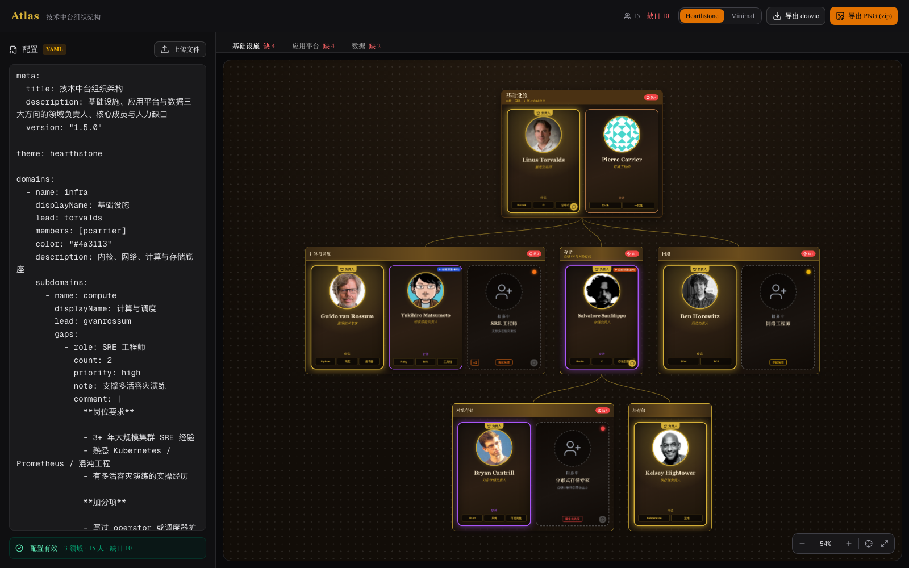
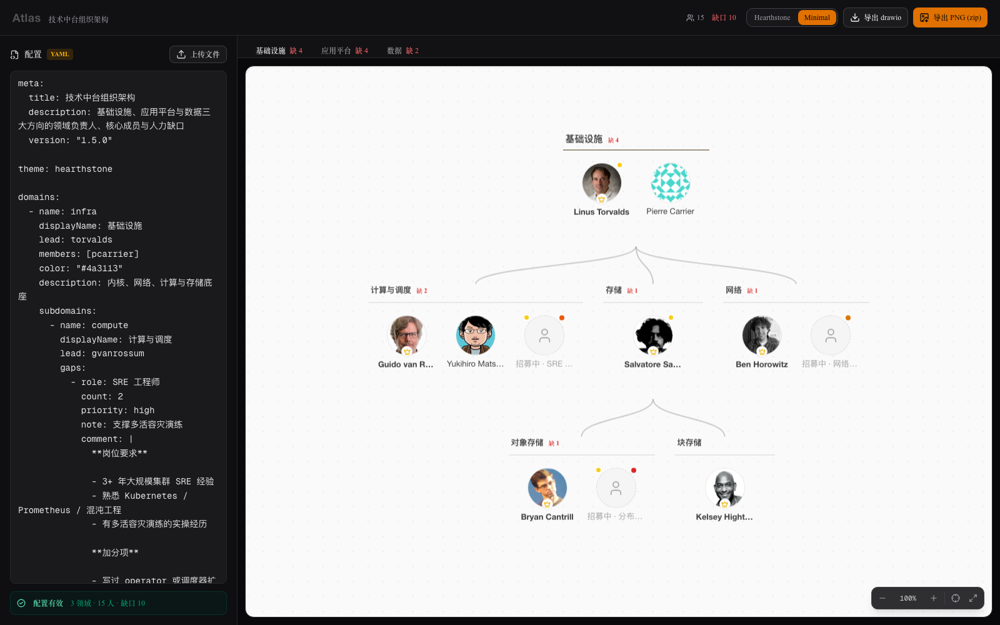
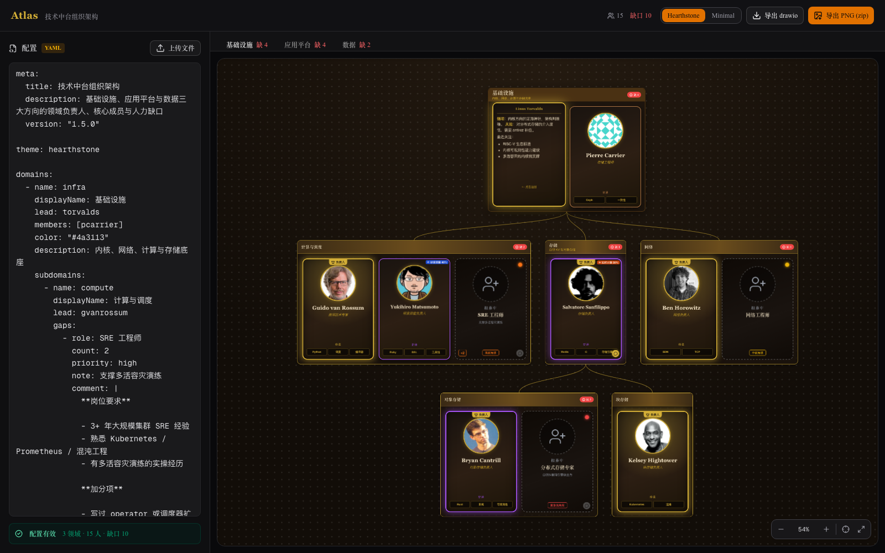

# Atlas

[](https://github.com/jiusanzhou/atlas/actions/workflows/ci.yml)
[](LICENSE)
[](https://vercel.com/new/clone?repository-url=https%3A%2F%2Fgithub.com%2Fjiusanzhou%2Fatlas)

配置驱动的组织架构 & 人力管理可视化平台。

一份 yaml/json/toml 配置，渲染出炉石风格的领域树 + 人物卡，突出：

- 领域负责人
- 核心成员
- 人力缺口（含负责人缺口）
- 借调交叉支撑

用来回答那些散落在表格里说不清的问题：**这个方向谁在负责？缺几个人？谁被借去了哪儿？**

## Screenshot

Hearthstone 主题 —— 领域树、人物卡、缺口卡：



Minimal 主题 —— 只留头像和名字，适合人多的大图：



点开人物卡看 Markdown 备注：



## 特性

- 🎴 卡牌风格可视化（Hearthstone / Minimal 两套主题）
- 🌲 领域树无限嵌套
- 📋 一份配置驱动全部渲染，YAML / JSON / TOML 自动识别
- 🖼 独立画布：拖拽 + 缩放 + fit，不会带着整个页面一起滚
- 💬 人物 Markdown 备注（翻卡 / hover 浮层）
- 🚨 缺口显示 & 负责人缺口
- 🔀 借调关系可视化
- 📤 导出 drawio（多 page，可继续编辑），或一键复制 XML 到剪贴板
- 🖼 导出 PNG（zip 打包，每个领域一张）
- 🌍 头像多来源：URL / file / gravatar / github / dicebear / initials

## 快速开始

```bash
pnpm i
pnpm dev
```

打开 <http://localhost:3000/>，左边编辑配置，右边实时出图。首屏载入 `examples/demo.yaml`。

> `pnpm i` 默认**不下载** Chrome（约 300MB）。这只影响 PNG 导出，其余功能都正常；要开启见 [PNG 导出需要 Chrome](#png-导出需要-chrome)。

## 配置字段参考

完整字段表、按能力查用法、校验规则见 **[docs/CONFIG.md](docs/CONFIG.md)**。下面是速查。

### 顶层结构

| 字段 | 类型 | 必填 | 默认 | 说明 |
| --- | --- | --- | --- | --- |
| `meta` | object | 否 | — | `title` / `description` / `version`。`title` 也用作导出文件名 |
| `theme` | enum | 否 | `hearthstone` | `hearthstone` \| `minimal` |
| `domains` | Domain[] | **是** | — | 至少一个。一个**顶层**领域 = 一个 tab = 导出的一页 |
| `people` | Person[] | **是** | — | 全量人员名册，可以是 `[]`，但字段必须存在 |

### Domain（领域）

| 字段 | 类型 | 必填 | 默认 | 说明 |
| --- | --- | --- | --- | --- |
| `name` | string | **是** | — | 唯一标识，被 `lead` / `members` / `homeDomain` / `lendTo.domain` 引用 |
| `displayName` | string | 否 | 回落 `name` | 界面显示名，适合写中文 |
| `lead` | string | 否 | — | 负责人 person `id`。**与 `leadGap` 互斥** |
| `leadGap` | Gap | 否 | — | 负责人空缺（等招）。**与 `lead` 互斥** |
| `members` | string[] | 否 | `[]` | 成员 person `id` 列表 |
| `gaps` | Gap[] | 否 | `[]` | 成员缺口 |
| `subdomains` | Domain[] | 否 | `[]` | 子领域，结构相同，可无限嵌套 |
| `color` | string | 否 | 主题色 | 领域框颜色，如 `"#4a3113"` |
| `description` | string | 否 | — | 领域说明 |

领域内卡片顺序固定：**负责人（真人或缺口）→ 成员真人 → 借入的人 → 成员缺口**。

### Person（人）

| 字段 | 类型 | 必填 | 默认 | 说明 |
| --- | --- | --- | --- | --- |
| `id` | string | **是** | — | 唯一标识 |
| `name` | string | **是** | — | 显示名 |
| `title` | string | 否 | — | 职位，显示在名字下方 |
| `homeDomain` | string | 否 | — | 主属地领域 `name`。**决定借调徽章方向** |
| `avatar` | string | 否 | 首字母头像 | 见[头像来源](#头像来源) |
| `tags` | string[] | 否 | `[]` | 技能标签，卡面最多显示 3 个 |
| `rarity` | enum | 否 | 自动推断 | `legendary` \| `epic` \| `rare` \| `common` |
| `lendTo` | Loan[] | 否 | `[]` | 借调去向 |
| `comment` | string | 否 | — | Markdown 备注，翻卡 / 浮层可见 |

`rarity` 省略时按顺序推断：负责人 → `legendary`，有借调 → `epic`，标签 ≥ 3 → `rare`，其余 `common`。

### Gap（缺口）

同一结构用在 `gaps[]`（成员缺口）和 `leadGap`（负责人缺口）两处。

| 字段 | 类型 | 必填 | 默认 | 说明 |
| --- | --- | --- | --- | --- |
| `role` | string | **是** | — | 缺什么角色，如 `SRE 工程师` |
| `count` | int | 否 | `1` | 缺几个，正整数。`> 1` 时卡面显示 `×N` |
| `priority` | enum | **是** | — | `critical`(红) \| `high`(橙) \| `medium`(黄) \| `low`(灰) |
| `note` | string | 否 | — | 一句话说明，纯文本 |
| `comment` | string | 否 | — | Markdown 招聘要求 |

缺口卡长得像「一个空位的人」：虚线框 + 虚线人形剪影 + 优先级色点。顶部与 tab 上的「缺 N」是 `count` 之和（含 `leadGap` 与所有子领域）。

### Loan（借调）

写在 person 的 `lendTo[]` 下。

| 字段 | 类型 | 必填 | 说明 |
| --- | --- | --- | --- |
| `domain` | string | **是** | 借调目标领域 `name` |
| `ratio` | number | **是** | 投入比例 `0`–`1` |
| `role` | string | 否 | 在目标领域做什么 |

**同图内**的借调画虚线箭头；**跨图**的只在卡角留徽章（橙 `→` 借出 / 蓝 `←` 借入）。`homeDomain` 决定方向，不写就只显示 `← 外部`。一个人在多个领域重复出现是设计如此（主属地 + 借调领域各一张）。

### 校验与报错

- **红色（阻塞渲染）**：缺必填字段、`lead` 与 `leadGap` 同时填、枚举拼错、语法错误。语法错误会报**具体行号**，schema 错误按 `domains[1].gaps[0].priority: 原因` 列出，一次最多 5 条
- **黄色（照常渲染）**：引用对不上 —— id 不存在、领域名不存在、id / name 重复

早期的 `business` / `blueprint` 主题是未完成的 stub，v1.6 已移除。**旧配置写了这两个值不报错**，自动回落 `hearthstone`；拼写错误（如 `hearthstne`）仍会报错。

### 最小可用示例

```yaml
domains:
  - name: infra
    lead: torvalds

people:
  - id: torvalds
    name: Linus Torvalds
```

## 配置示例

```yaml
meta:
  title: 技术中台组织架构

theme: hearthstone

domains:
  - name: infra
    displayName: 基础设施
    lead: torvalds
    color: "#4a3113"
    subdomains:
      - name: compute
        displayName: 计算与调度
        lead: gvanrossum
        gaps:
          - role: SRE 工程师
            count: 2
            priority: high
            note: 支撑多活容灾演练
  - name: platform
    displayName: 应用平台
    leadGap:                       # 负责人空缺，与 lead 互斥
      role: 平台负责人
      priority: critical

people:
  - id: torvalds
    name: Linus Torvalds
    title: 首席架构师
    homeDomain: infra
    avatar: github:torvalds
    tags: [Kernel, C, 分布式]
    rarity: legendary
    comment: "**强项**：内核方向的定海神针。"
  - id: gvanrossum
    name: Guido van Rossum
    homeDomain: compute
    lendTo:
      - domain: platform           # 借调 30% 到应用平台
        ratio: 0.3
        role: 调度层支撑
```

完整版见 [`examples/demo.yaml`](examples/demo.yaml)。

## 导出

header 右上角三个入口，都以**顶层领域**为单位切分：

- **导出 drawio**：下载 `.drawio` 文件，直接用 draw.io 打开
- **复制 XML**：把 drawio XML 复制到剪贴板，粘贴到 draw.io 的 "编辑 → 从 XML 导入" 里
- **导出 PNG (zip)**：每个顶层领域一张 PNG，打包下载

### drawio

- 每个顶层领域一个独立 `<diagram>` **page**，页名就是领域显示名
- 全部是原生 mxGraph cell，在 draw.io / diagrams.net 里**可以继续编辑**，不栅格化
- 头像抓取后内联成 data URI，离线打开也有头像（因此文件偏大，demo 约 2MB）
- 人物 / 缺口的备注写进 cell 的 value，可搜索、可编辑
- 文件名 `{meta.title}.drawio`

「复制 XML」在**浏览器本地**生成同样的 XML，不走 `/api/drawio`，所以离线也能用、也更快。代价是头像保持 URL 而不内联成 data URI，因此体积小很多（demo 约 90 KB），但 draw.io 里显示头像需要联网。剪贴板被浏览器拦下时会依次回退到 `execCommand('copy')`，最后弹出全文让你手动复制。

### PNG

- 每个顶层领域一张 PNG，条目名 `atlas-{领域显示名}.png`，打包成 zip
- 2 倍图（`deviceScaleFactor: 2`）
- 服务端用 headless Chrome 截 `/render` 页面，**依赖运行环境有可用的 Chrome**

> macOS 自带的 `unzip` 会忽略 zip 的 UTF-8 文件名标志位，中文条目名会报 `Illegal byte sequence`。这不是导出的 bug，用 `ditto -x -k atlas.zip ./out` 或 Finder 双击解压即可。

### PNG 导出需要 Chrome

`pnpm i` 默认跳过 Chrome 下载（`package.json` 的 `puppeteer.skipDownload`）。任选一种开启：

```bash
# 1. 用系统已装的 Chrome（推荐，不占额外空间）
PUPPETEER_EXECUTABLE_PATH="/Applications/Google Chrome.app/Contents/MacOS/Google Chrome" pnpm start

# 2. 单独装一份 puppeteer 自带的
pnpm exec puppeteer browsers install chrome-headless-shell

# 3. 装依赖时就一起下载
PUPPETEER_SKIP_DOWNLOAD=false pnpm i
```

导出接口还会自动扫几个常见的系统 Chrome 路径，多数机器上不配也能跑。

### HTTP API

| 接口 | 说明 |
| --- | --- |
| `POST /api/parse` | 三格式统一解析，返回 Config、stats 与引用告警 |
| `POST /api/drawio` | 返回 mxGraph XML（多 page） |
| `POST /api/export` | 返回 zip（每个顶层领域一张 PNG），支持 `scale` / `width` |

请求体给 `{"source": "<配置文本>"}` 或 `{"config": {...}}`。

```bash
curl -X POST localhost:3000/api/drawio \
  -H 'Content-Type: application/json' \
  -d "{\"source\": $(node -e 'console.log(JSON.stringify(require("fs").readFileSync("examples/demo.yaml","utf8")))')}" \
  -o atlas.drawio
```

`/render?config=<urlencoded json>&domain=<顶层领域名>&theme=minimal` 是无编辑器外壳的纯渲染页，一次渲染一个顶层领域，PNG 导出逐个访问它。

## 头像来源

`avatar` 支持这些写法，都不需要配图片域名白名单：

| 写法 | 示例 | 说明 |
| --- | --- | --- |
| `github:用户名` | `github:torvalds` | GitHub 头像 |
| `gravatar:邮箱` | `gravatar:a@example.com` | 按邮箱 MD5 取 Gravatar，无图时 identicon |
| `dicebear:风格` | `dicebear:bottts` | DiceBear 生成，以 person `id` 为种子 |
| `https://` / `http://` | `https://example.com/a.png` | 直接给 URL |
| `data:` | `data:image/png;base64,...` | 内联图片 |
| `file://相对路径` | `file://avatars/zoe.png` | 相对 `examples/` 读取，仅服务端，禁止 `../` 越出 |
| `initials` 或省略 | — | 名字首字母 SVG（中文取一字），底色由名字哈希决定 |

任何来源取不到图都会退回首字母头像，不会出现破图。

## 部署

### 本地

```bash
pnpm build && pnpm start
```

### Docker

```bash
docker build -t atlas . && docker run -p 3000:3000 atlas
```

`node:22-alpine` 多阶段构建 + Next.js standalone 输出，镜像里装了 Alpine 的 `chromium`，所以 **Docker 里 PNG 导出可用**；另带 `font-noto-cjk`，中文不会渲染成方框。

### Vercel

零配置即可部署，或用 README 顶部的一键部署按钮。

⚠️ **Vercel 部署不支持 PNG 导出** —— serverless 函数里跑不了完整的 puppeteer + Chrome。渲染、编辑、drawio 导出全部正常，只有「导出 PNG (zip)」会失败。需要 PNG 就用 Docker 或自建。

## 开发

```bash
pnpm dev          # 开发服务器
pnpm build        # 生产构建
pnpm start        # 跑生产构建
pnpm typecheck    # tsc --noEmit
pnpm test         # vitest run
pnpm test:watch   # vitest watch
pnpm lint         # eslint
```

CI（GitHub Actions）在每次 push / PR 上跑 `typecheck` → `test` → `build`。

单测覆盖 schema 校验、三格式解析、drawio XML 生成。`scripts/` 下另有一批 puppeteer 验证脚本（画布交互、主题、缺口卡、导出回归、截图），需要先起服务再跑。

### 架构

```
lib/schema.ts      zod schema + 类型（Domain 递归用 z.lazy）
lib/parser.ts      三格式识别与解析 + 交叉引用校验 + 错误定位
lib/layout.ts      单个顶层领域 → 自上而下树布局（d3-hierarchy），输出画布绝对坐标
lib/avatar.ts      头像 fallback 链（sync 给渲染，async 给 file:// 与 base64 内联）
lib/md5.ts         gravatar 需要 MD5，WebCrypto 不提供，同构实现
lib/drawio.ts      mxGraph XML 生成（多 page）
lib/themes/        主题 token
components/Canvas  可拖拽缩放的画布容器（手写，无 pan/zoom 依赖）
components/        DomainTree → DomainCard → PersonCard / GapCard / MinimalCard
```

**一份几何，两种输出**：`lib/layout.ts` 产出画布绝对坐标，web 与 drawio 共用，所以两边排版一致。节点宽度随人员数变化，因此 d3 `tree()` 用 `nodeSize([1, 1])` 把 x 单位当像素，真实间距全交给 `separation`；每层 y 按该层最高节点单独累加，避免层高被最深分支拉齐。

**主题是 token 而非 if 分支**：`ThemeTokens.variant` 决定组件走哪条渲染分支（`card` / `minimal`），`geometry` 让主题覆盖默认间距与列数。加主题优先加 token，不要往组件里塞 `if (theme.name === ...)`。

**借调的边界**：只画**同图内**的虚线箭头（借出方和借入方两张卡都落在这棵树里）；跨图的借调只在卡角留徽章（橙 `→` 借出 / 蓝 `←` 借入）。虚线因此空出来给借调专用，领域→子领域连线用实线。

## 路线图

- v2：Web UI 编辑器（不再手写 yaml）
- 多用户 / 权限 / 历史版本
- Business / Blueprint 主题完整实现（目前是未完成的配色 stub，已从可选列表移除）
- 数据源接入（LDAP / HR 系统）

## License

MIT © Zoe

---

## English

**Atlas** is a config-driven visualization platform for org structure and headcount planning.

Feed it one YAML/JSON/TOML file and it renders a Hearthstone-style domain tree with person cards, highlighting domain leads, core members, headcount gaps (including vacant lead seats), and cross-team loans.

- Two themes: `hearthstone` (rich cards) and `minimal` (avatar + name, details on hover)
- Infinitely nestable domain tree; one pan/zoom canvas per top-level domain
- Markdown notes on people and gaps, via card flip or hover panel
- Export to **drawio** (one editable page per top-level domain) and **PNG** (zipped, one image per domain)
- Avatars from GitHub, Gravatar, DiceBear, URLs, local files, or generated initials

Quick start: `pnpm i && pnpm dev`, then open <http://localhost:3000/>.

Full field reference: [docs/CONFIG.md](docs/CONFIG.md). Deploy with Docker (PNG export works) or Vercel (PNG export does **not** — serverless can't run headless Chrome).

MIT © Zoe
